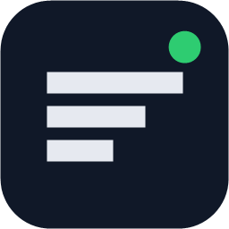
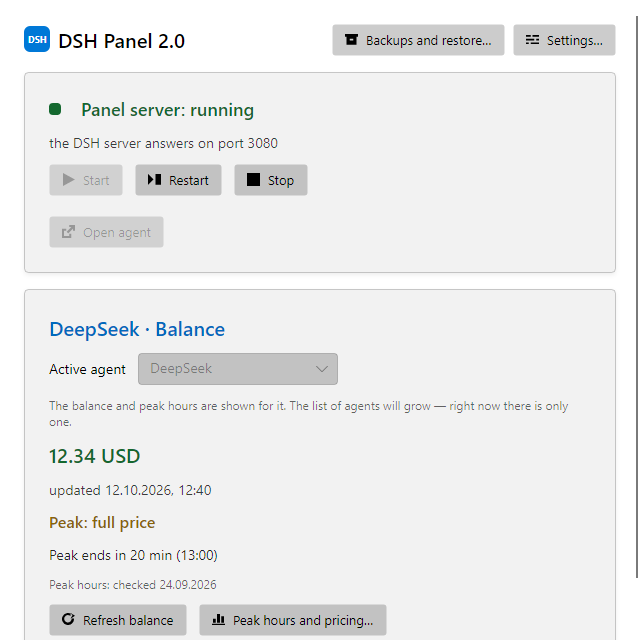
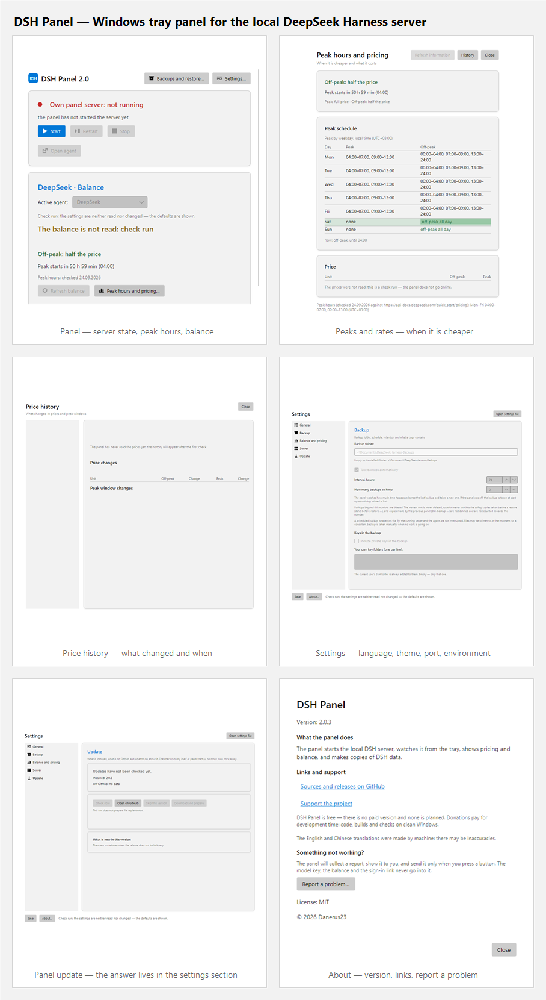

<p align="center">
  
</p>

<h1 align="center">DSH Panel</h1>

<p align="center">
  A control panel for the local <b>DeepSeek Harness</b> server on Windows:<br>
  it runs the server and watches it from the tray, installs and updates DSH itself from a verified
  set of versions, shows balance and peak windows, makes and restores copies, answers the agent's
  question from your phone, and updates itself.
</p>

<p align="center">
  <a href="https://github.com/Danerus23/dsh-panel/releases/latest"></a>
  <a href="LICENSE"></a>
  
  
  <a href="https://github.com/Danerus23/dsh-panel/releases"></a>
</p>

<p align="center">
  <a href="#whats-new-in-220">What's new in 2.2.0</a> ·
  <a href="#how-to-update">How to update</a> ·
  <a href="#installation">Installation</a> ·
  <a href="#what-it-does">What it does</a> ·
  <a href="#what-is-missing">What is missing</a> ·
  <a href="#screenshots">Screenshots</a> ·
  <a href="#building-from-source">Building from source</a> ·
  <a href="#support-the-project">Support</a> ·
  <a href="README.ru.md">Русский</a> ·
  <a href="README.zh.md">中文</a>
</p>



**Your DSH server, under control** — and out of the way in the tray. One file, `DshPanel.exe`:
installed into your user profile, no administrator rights, no separate .NET install — the runtime is
inside. This panel version is **2.2.0**.

Start and stop the server, install, update and roll back DSH from a verified set, a tray icon that
shows its state, your balance, peak windows and price history, copies of your data with restore, the
agent's question answered from your phone, and the panel updating itself — all of it **in three
languages: Russian, English and Chinese**.

Peak windows are shown in **your local time**, prices come with a history of changes rather than from
memory, and the sign-in link opens only when you click it.

Nothing to unpack by hand: the panel installs DSH from npm by a verified set of versions, and it
needs the network for that. What it does not do is in [“What is missing”](#what-is-missing).

Russian is the original. **English and Chinese are machine translations:** the meaning is right, but
some wording may not sound native.

## What's new in 2.2.0

* **The panel keeps two versions of the DSH server side by side** — the current and the previous
  one — and installs each from its own verified set. The 0.2.x line has its own set: 683 packages,
  the set file's sum pinned in the build, the install checked by a real `npm ci`, and the installed
  tree passes the panel's full probe.
* **A fresh version is installed by a separate button with a confirmation** and an honest line:
  “newer, but the panel has not verified it”. Verified remains **0.1.5-rc.2**.
* **Before switching versions the panel counts the sessions on disk and says in numbers** how many
  of them the old DSH server will not see — and after a rollback it repeats that number. Visibility
  is returned in one step, and the step is named in words rather than done silently.
* **The phone shows only the conversations that can be opened:** subagent sessions do not appear in
  the list, and their number goes to the panel's journal. An answer the server did not accept is no
  longer passed off as sent.
* **Backups: the window no longer gets stuck, and the archive no longer flickers** as an unfinished
  file — it appears in one appearance, already checked.

## How to update

Open the **“Update”** section and press **“Check now”**. The panel finds 2.2.0, downloads
`DshPanel.zip` from this release, checks its SHA-256 and replaces its files **after the panel
exits**; a safety copy of the previous version is taken first. Nothing to unpack or uninstall by
hand.

`dsh-panel-setup.exe` from the files below is for a **closed** panel: it stops a running panel
itself, so leave the panel from the tray menu first — “Exit”, not “Stop”: “Stop” shuts down the DSH
server together with the agent's work.

Whom this update is not for and what the panel does not do — [“What is missing”](#what-is-missing).

## Installation

1. Download `dsh-panel-setup.exe` from the [latest release](../../releases/latest) and run it. It
   installs the panel **into your user profile** — `%LOCALAPPDATA%\Programs\DSH Panel` — and **asks
   for no administrator rights**.
2. Or take the portable `DshPanel.zip`: unpack it anywhere and run `DshPanel.exe`. That changes
   nothing on the system.
3. Then press **Start** — the panel brings up your DSH server and shows its state. The entry link
   opens in your browser from a separate button.
4. No DSH server at all — the “Update” section installs it from a verified set; the panel says
   itself what is missing on the first run.

If you already have an **earlier panel**, the installer goes over it: both use the same package
identity, so the tray keeps one panel, not two. An earlier panel can also update itself — see
[“How to update”](#how-to-update).

**What it needs:** Windows 10 or 11, x64. No .NET install. It also needs the network: DSH is
installed from npm by a verified set (see “What is missing”).

## What it does

### The server

Start, restart and stop the local DSH server. The panel shows the real state: running, stopped, or
the port taken by another program. The entry link opens in your browser **only when you click it** —
the panel never opens it by itself and never shows it. Next to it is the server log: you can read
what the server printed while starting.

### Picking up a server that is already running

If a DSH server is already up, the panel finds it on port 3080 or on another port, shows you the
finding and asks whether to take it under control. Your answer is **remembered**, so from the next
start the same server is taken automatically. While a foreign server answers, the panel does not
start its own — no second engine on the same data. If more than one DSH runs on the machine, the
panel shows a row for each, marked “the panel's server” or “a found server”, and each has its own
“Take over” button.

### The DSH server: install, update, roll back

The panel installs the DSH server **from a verified set of versions** — exact versions and sums of
every package — and after the install the tree is checked against the set path by path. The
“Update” section has a “DSH server” block: the first line is **your own** version, then the
**recommended** (verified) one and the **fresh** one from the npm registry, with words about how
they differ. The main button installs the verified version only; the fresh one is a separate action
with a confirmation; when there is no server at all, the button is called “Install”.

Before replacing a version the panel always asks: “will stop the DSH server, take a copy, install
{version}; agent work will be interrupted”. It takes a safety copy of the profile (a failed copy
refuses the update — there is no such thing as half an archive), stops **only its own** server,
installs the verified version and **checks what was installed live**: raises it on a free port in
its own temporary home and runs the probe. Passed — the server comes back up on the new version;
failed or broken — the **previous** one comes back. Words before the deed, one line after it.

The “Return to version {X}…” line under the buttons is visible only when there is somewhere to
return to. The return goes into the **own** folder of the previous version: the panel keeps **two**
versions on disk — the current and the previous one — and each is installed **from its own verified
set** (the 0.2.x line has its own: 683 packages, the set file's sum pinned in the build). If the
system Node does not fit by version, the panel downloads **its own** — from the official source and
with the sum checked; the Node threshold is taken **no weaker than the strictest** of the sets, so
that a rollback does not raise the previous version on an unsuitable Node.

About sessions the panel speaks **in numbers**, not in general words: “DSH server {version} will
not see N of M sessions: their journal is already in the new format, and it will not say so — they
will disappear from the list silently”. The history is intact; visibility is returned in one step —
remove the new journal file (session.v4) from the session folder — and the panel does not do that
itself. The numbers come from the disk: the panel counts journal file names and reads no content.
After a successful rollback the final line repeats the number in the past tense.

### The phone

The settings have a “Phone” section: the “Allow the phone” switch, the port, the “Show the code” button —
**six digits** with a lifetime, the list of connected devices with “Unlink” next to each, and the
address the panel waits on for the phone. Next to it is a **QR code** with the address and port: a
camera opens the phone page straight away, no need to type the code by hand. The tray menu carries a
“Phone: connected” or “Phone: waiting to connect” line.

The phone page is the agent's question in words, with answer choices: you can answer by choosing or
in your own words if none of the choices fits, and the answer goes **once**. A separate “Cancel the
agent's run” button says plainly that the work of that run will not continue. The firewall rule for
the phone is placed **only when you click**, and it is narrow: private profile only, the panel's
port only, this program only and your own subnet only.

The phone shows **only root conversations**: a subagent session cannot be opened without the
parent's address, so it is not in the list, and the panel writes the number of hidden ones into its
journal. An answer counts as sent only when the server **accepted** it: “not accepted” is shown to
the phone as a refusal, and the question stays open.

The phone works on your own network and makes no external connections. Setting tasks and managing
agents from the phone are in development.

### The tray

The tray icon shows the state in colour: green — the server answers, red — it does not, grey — the
panel knows nothing about the server. A peak dot sits in the corner of the icon. Clicking the icon
opens the window, the right button opens the menu, and the menu header carries three state lines:
the server, the agent with its balance, and the tariff. Both the close button and “minimise” send
the window to the tray: the server keeps running.

### Balance and peak windows

Balance is read with the key of the active model and refreshed on a schedule. Peak windows are shown
in **your local time**. The panel tells you when a peak is about to start and when the balance falls
below your threshold, and how long is left until the tariff switches. A balloon on start says where
the panel lives.

### Prices and price history

The “Cost” table is parsed from the pricing page. Separately the panel keeps a **history of
changes**: a record appears only when prices or peak windows have **actually changed**. Each new
record is compared with the previous one, the newest is marked “current”, a price rise is shown in
red with an up arrow and a drop in green with a down arrow. When something changes, the balloon says
**what exactly** changed.

### Copies and restore

A copy of your DSH data is a ZIP archive. The panel lists the copies it has, and before restoring it
lays out a plan: what exactly will come back and where, changing nothing on disk. Restoring takes a
safety copy of the current state first, automatic copies are taken on a schedule and rotated, and
the size of a copy is one of three modes. **Private keys** outside `~/.dsh` go into a copy only with a
separate permission, and then the archive itself becomes the key. A **“copy to hand over”** is a
one-off action, not a setting: the checkbox in the copies window clears itself after the copy, a copy
without a window has its own `--shareable` switch, and scheduled copies are never shareable. The
access-key file is not put into such a copy at all, so it can be given to another person. **Private
keys together with a copy to hand over are refused** — the panel says why, in words.

### Updating itself

The panel asks for releases once a day, shows the release notes **in the panel's own language** and
can “skip this version”. The answer — both what you have and what is out — lives **in the settings,
in the “Update” section**: there is no separate update window. What the panel downloads is checked
against SHA-256, unpacked with a version check, and the files are replaced by a separate script
**that can roll back** to the previous version. The panel then tells you the outcome in words:
updated, rolled back, or the panel folder was not the one it replaced.

### Three languages

Russian, English and Chinese. The language switch is in the settings.

### Reporting a problem

The “About” window has a report button. The panel assembles a technical report and **shows you
exactly the text that will leave**. Nothing is sent on its own: the report goes out only when you
press a button — open a new issue in your browser, copy it, or save it to a file. The model key,
the balance and the entry link never get into the report.

### Settings

Start with Windows, theme (light, dark, or as in Windows), the port of the panel's own server, and
the server working folder. The “Server” section carries an environment report: what the panel
looked for, what it found, which versions of DSH, Node, npm and pnpm are installed and where exactly
— with paths. The same section carries the table of skills: what the panel can do with this DSH
server, each skill in words.

## What is missing

* **The phone answers the agent's question and nothing else yet.** Setting tasks and managing agents
  from the phone are in development. Its traffic goes over your network **unencrypted** — the
  sign-in is protected by the six-digit code and the device pass — and it makes no external
  connections.
* **No engine and no Node come with the download.** The installer and the archive carry neither: the
  panel installs DSH **from npm** by a verified set, so the network is needed. The system Node is
  used when it fits; otherwise the panel downloads its own.
* **There is no code signing — SmartScreen will warn you.** On the first run it will say the
  publisher is unknown: no signing certificate was bought. That is expected; you can still run the
  installer through “More info” → “Run anyway”.
* **The panel installs and updates only ITS OWN DSH server.** It never touches a foreign
  installation: it shows the version and what it can do with it. A fresh version from the registry
  is shown, and installed only when its own set exists — by a separate button with a confirmation.
  “A set exists” does not mean “verified”: verified remains **0.1.5-rc.2**, and the panel says
  exactly that about 0.2.1.
* **Subagent sessions do not open from the phone** — they need the parent's address. The phone does
  not show them, and the number of hidden ones goes to the panel's journal.
* **The peak schedule is weekly.** The table runs by days of the week, the same as on the pricing
  page, and knows no Chinese holidays.

## Screenshots

Every window comes in all three languages — the language switch lives in the settings.



Several panel windows at once.

| | English | Русский | 中文 |
| --- | --- | --- | --- |
| Main window | [panel](docs/screenshots/en/panel.png) | [панель](docs/screenshots/ru/panel.png) | [面板](docs/screenshots/zh/panel.png) |
| Peaks and prices | [peaks](docs/screenshots/en/peaks.png) | [пики](docs/screenshots/ru/peaks.png) | [价格高峰](docs/screenshots/zh/peaks.png) |
| Price history | [price history](docs/screenshots/en/pricing-history.png) | [история цен](docs/screenshots/ru/pricing-history.png) | [价格历史](docs/screenshots/zh/pricing-history.png) |
| Settings | [settings](docs/screenshots/en/settings.png) | [настройки](docs/screenshots/ru/settings.png) | [设置](docs/screenshots/zh/settings.png) |
| About | [about](docs/screenshots/en/about.png) | [о программе](docs/screenshots/ru/about.png) | [关于](docs/screenshots/zh/about.png) |
| Panel update (settings section) | [update](docs/screenshots/en/update.png) | [обновление](docs/screenshots/ru/update.png) | [更新](docs/screenshots/zh/update.png) |
| Phone (settings section) | [phone](docs/screenshots/en/phone.png) | [телефон](docs/screenshots/ru/phone.png) | [手机](docs/screenshots/zh/phone.png) |
| DSH server (settings section) | [server](docs/screenshots/en/server.png) | [сервер](docs/screenshots/ru/server.png) | [服务器](docs/screenshots/zh/server.png) |
| First run | [first run](docs/screenshots/en/first-run.png) | [первый запуск](docs/screenshots/ru/first-run.png) | [首次启动](docs/screenshots/zh/first-run.png) |

## Building from source

```powershell
git clone https://github.com/Danerus23/dsh-panel.git
cd dsh-panel

dotnet build DshPanel.slnx -c Release
dotnet test tests\DshPanel.Tests\DshPanel.Tests.csproj -c Release
dotnet publish src\DshPanel\DshPanel.csproj -p:PublishProfile=win-x64 -o dist
```

The publish profile produces a single self-contained `DshPanel.exe` with .NET, Skia and HarfBuzz
inside — the machine that runs it needs no .NET install.

Building needs the **.NET SDK 10** (the version is pinned in `global.json`) and a network
connection, because packages come from NuGet. The installer is built by
[Inno Setup 7](https://jrsoftware.org/isdl.php) through `installer\build-installer.ps1`, which also
places the release file in `dist\`. The build itself needs no Node and no pnpm — those bring the
server up, they do not build the panel.

## Support the project

The panel is free, open and will stay that way — there is no paid version and none is planned;
donations cover development time: code, builds and checks on clean Windows go through
[lava.top](https://app.lava.top/3686297587).

> **Unofficial tool.** DSH Panel is a panel for the DeepSeek Harness agent: it runs the official
> `dsh` command line and does not change it. DeepSeek and DeepSeek Harness are trademarks of their
> owner.

## License

MIT — see [LICENSE](LICENSE).
