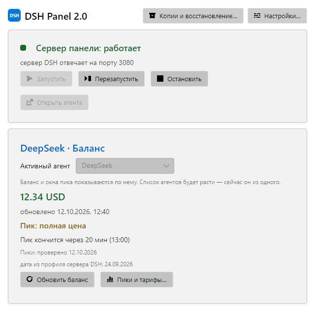

<p align="center">
  
</p>

<h1 align="center">DSH Panel</h1>

<p align="center">
  Панель управления локальным сервером <b>DeepSeek Harness</b> для Windows:<br>
  поднимает сервер и следит за ним из трея, сама ставит и обновляет DSH по проверенному набору
  версий, показывает баланс и окна пика, делает и возвращает копии, отвечает на вопрос агента
  с телефона и обновляет себя.
</p>

<p align="center">
  <a href="https://github.com/Danerus23/dsh-panel/releases/latest"></a>
  <a href="LICENSE"></a>
  
  
  <a href="https://github.com/Danerus23/dsh-panel/releases"></a>
</p>

<p align="center">
  <a href="#что-нового-в-230">Что нового в 2.3.0</a> ·
  <a href="#как-обновиться">Как обновиться</a> ·
  <a href="#установка">Установка</a> ·
  <a href="#что-умеет">Что умеет</a> ·
  <a href="#чего-нет">Чего нет</a> ·
  <a href="#снимки-окон">Снимки окон</a> ·
  <a href="#сборка-из-исходников">Сборка из исходников</a> ·
  <a href="#поддержать-проект">Поддержать</a> ·
  <a href="README.md">English</a> ·
  <a href="README.zh.md">中文</a>
</p>



**Сервер DSH под рукой** — и целиком в трее. Один файл `DshPanel.exe`: ставится в профиль
пользователя, права администратора не нужны, .NET ставить не надо — он внутри. Версия панели —
**2.3.0**.

Запуск и остановка сервера, установка и обновление DSH по проверенному набору версий, живой
значок состояния, баланс, окна пика и история цен, копии данных с восстановлением, ответ на вопрос
агента с телефона, обновление панели — и всё это **на трёх языках: русский, английский,
китайский**.

Пик виден **в вашем местном времени**, цены — из истории изменений, а не из памяти.
Ссылка входа откроется только тогда, когда вы сами нажмёте кнопку.

Распаковывать руками ничего не нужно: DSH панель ставит сама из npm по проверенному набору
версий — для этого нужна сеть. Что панель не делает — коротко в разделе
[«Чего нет»](#чего-нет).

Русский — язык оригинала. **Английский и китайский переведены машинно:** смысл передан верно,
но отдельные формулировки могут звучать не по-родному.

## Что нового в 2.3.0

* **Версия сервера DSH по умолчанию — линия 0.2.x: `0.2.1-rc.2`.** Её ставит главная кнопка
  «Обновить», и ставит по её собственному набору: 683 пакета, сумма файла закреплена в сборке,
  а поставленное дерево проходит полную пробу панели — **77 из 77** нужных имён и **8 из 8** умений.
* **Поверхность сошлась:** у этой версии объявлено **144** имени = **77** нужных панели + **67**
  новых в 16 семействах; семь прежних имён панель больше не зовёт, и это названо строкой,
  а не проглочено молча.
* **Телефон проверен на этой связке:** в изоляции — **74 из 74**, провалов 0, белый список остался
  **13** вызовов; а живой вопрос агента с настоящего телефона прошёл — вопрос показан, ответ ушёл
  в сервер, ход агента продолжился.
* **Прежняя проверенная `0.1.5-rc.2` остаётся — к ней возвращает откат.** Но оговорку прочитайте
  до возврата: журнал сессий у линии 0.2.x — **v4**, и сессии, открытые под 0.2.1, прежний движок
  не увидит и **не скажет об этом**; панель называет число до возврата.
* **Баланс больше не заставляет угадывать валюту:** `USD: пополнено … · бонус …` и
  `CNY: пополнено … · бонус …` — подписано, где что.

## Как обновиться

Откройте раздел **«Обновление»** и нажмите «Проверить сейчас». Панель найдёт 2.3.0, скачает
`DshPanel.zip` из этого выпуска, сверит сумму и заменит файлы **после выхода** панели; перед
заменой снимается страховочная копия прежней версии. Распаковывать и удалять что-либо руками
не нужно.

Установщик `dsh-panel-setup.exe` (в файлах выпуска) — для **закрытой** панели: он сам гасит
работающую. Поэтому сначала «Выход» из меню значка, а не «Остановить»: «Остановить» гасит сервер
DSH вместе с работой агента.

Кому это обновление не нужно и чего панель не делает — [«Чего нет»](#чего-нет).

## Установка

1. Скачайте установщик `dsh-panel-setup.exe` из [последнего выпуска](../../releases/latest) и
   запустите его. Он ставит панель **в профиль текущего пользователя** —
   `%LOCALAPPDATA%\Programs\DSH Panel` — и **прав администратора не просит**.
2. Либо возьмите переносимый архив `DshPanel.zip`: распакуйте в любую папку и запустите
   `DshPanel.exe`. Установка при этом ничего не меняет.
3. Затем нажмите **«Запустить»** — панель поднимет ваш сервер DSH и покажет состояние. Ссылка
   входа откроется в браузере по отдельной кнопке.
4. Сервера DSH нет вовсе — его поставит раздел «Обновление» по проверенному набору; чего
   не хватает, панель скажет сама при первом запуске.

Если у вас уже стоит **более ранняя панель**, установщик встанет поверх неё: у обеих версий один
идентификатор пакета, поэтому в трее останется одна панель, а не две. Ранняя панель умеет
обновиться и сама — см. [«Как обновиться»](#как-обновиться).

**Что нужно:** Windows 10 или 11, x64. .NET ставить не нужно. Нужна сеть: DSH ставится
из npm по проверенному набору (см. «Чего нет»).

## Что умеет

### Сервер

Запуск, перезапуск и остановка локального сервера DSH. Панель показывает настоящее состояние:
работает, остановлен или порт занят чужой программой. Ссылка входа открывается в браузере
**только по щелчку** — сама панель её никуда не отправляет и не показывает. Рядом лежит журнал
сервера: видно, что он печатал при запуске.

### Подхват уже работающего DSH

Если сервер DSH уже поднят — панель находит его на порту 3080 или на другом порту, показывает
находку и спрашивает, брать ли её под управление. Ответ **запоминается**: со следующего запуска
тот же сервер берётся сам. Пока рядом отвечает чужой сервер, свой панель не поднимает — второго
движка на тех же данных не появляется. Если на машине работает не один DSH, панель показывает
строку на каждый с пометкой «сервер панели» или «найденный сервер», и у каждого — своя кнопка
«Взять под управление».

### Сервер DSH: установка, обновление, возврат

Панель ставит сервер DSH **по проверенному набору версий** — точные версии и суммы всех пакетов —
и после установки сверяет состав дерева с набором по путям. В разделе «Обновление» есть блок
«Сервер DSH»: первой строкой **своя** версия, дальше **рекомендуемая** (проверенная) и **свежая**
(из реестра npm) — своими словами о том, чем они отличаются. Главная кнопка ставит проверенную
версию — сейчас это **`0.2.1-rc.2`**, и ставит она её **по её собственному набору**; прежняя
проверенная **`0.1.5-rc.2`** остаётся версией возврата. Свежая версия ставится отдельным действием
с подтверждением; если сервера нет вовсе, кнопка называется «Установить».

Перед подменой версии панель спрашивает всегда: «остановит сервер DSH, снимет копию, поставит
{версию}; работа агента прервётся». Она снимает предохранительную копию профиля (неудавшаяся
копия отказывает обновлению — полуархива не бывает), гасит **только свой** сервер, ставит
проверенную версию и **проверяет поставленное живьём**: поднимает его на свободном порту в своём
временном доме и прогоняет пробу. Прошло — сервер поднимается заново уже на новой версии;
не прошло или сорвалось — поднимается **прежний**. Слова — до дела, одна строка — после.

Строка «Вернуться к версии {X}…» под кнопками видна только тогда, когда возвращаться есть куда.
Возврат идёт в **свою** папку прежней версии: на диске панель держит **две** версии — текущую
и прежнюю, — и каждая ставится **по своему проверенному набору** (у линии 0.2.x свой: 683 пакета,
сумма файла набора закреплена в сборке). Если системный Node не годится по версии, панель
скачивает **свой** — с официального источника и со сверкой суммы; порог Node берётся **не слабее
самого строгого** из наборов, чтобы возврат не поднял прежнюю версию на негодном Node.

Про сессии панель говорит **числом**, а не общими словами: «Сервер DSH {версия} не увидит N из M
сессий: их журнал уже в новом формате, и об этом он не скажет — они исчезнут из списка молча».
История цела; вернуть видимость можно одним шагом — убрать файл нового журнала (session.v4)
из папки сессии, — и панель этого сама не делает. Числа она берёт с диска: считает имена файлов
журнала, а содержимое не читает. После удачного возврата итоговая строка повторяет число
в прошедшем времени.

### Телефон

В настройках раздел «Телефон»: рубильник «Разрешить телефон», порт, кнопка «Показать код» —
**шесть цифр** со сроком жизни, список подключённых устройств с «Отвязать» у каждого и адрес,
по которому панель ждёт телефон. Рядом — **QR-код** с адресом и портом: камера открывает
страницу телефона сразу, код набирать руками не нужно. В меню значка есть строка
«Телефон: подключён» или «Телефон: ждёт подключения».

Страница телефона — это вопрос агента словами и вариантами ответа: ответить можно выбором или
своим текстом, если ни один вариант не подошёл, и ответ уходит **один раз**. Отдельная кнопка
«Отменить ход агента» прямо предупреждает, что работа этого хода не продолжится. Правило
брандмауэра для телефона ставится **только по вашему щелчку**, и оно узкое: только частный
профиль, только порт панели, только эта программа и только своя подсеть.

Телефон показывает **только корневые разговоры**: подчинённую сессию нельзя открыть без адреса
родителя, поэтому её в списке нет, а число скрытых панель пишет в свой журнал. Ответ считается
отправленным только тогда, когда сервер его **принял**: «не принято» телефону показывается
отказом, и вопрос остаётся открытым.

Телефон работает в своей сети и наружу не выходит. Постановка задачи и управление агентами
с телефона — в разработке.

### Трей

Значок в трее показывает состояние цветом: зелёный — сервер отвечает, красный — нет, серый —
панель про сервер ничего не знает. В углу значка — огонёк пика. Щелчок по значку открывает окно,
правая кнопка — меню, а в шапке меню три строки состояния: сервер, агент с балансом и тариф.
И крестик, и «свернуть» убирают окно в трей: сервер при этом продолжает работать.

### Баланс и пики

Баланс по ключу активной модели, обновляется по расписанию. Окна пика показываются **по вашему
местному времени**. Панель уведомляет, что скоро начнётся пик и что баланс опустился ниже
порога, и говорит, сколько осталось до переключения тарифа. О запуске панели сообщает шарик —
чтобы было понятно, где она живёт.

### Тарифы и история цен

Таблица «Стоимость» собирается со страницы цен. Отдельно ведётся **история изменений**: запись
появляется только тогда, когда цены или окна пика **действительно изменились**. Новая запись
сравнивается с предыдущей, свежая подписана «текущие», подорожание показано красным вверх,
удешевление — зелёным вниз. Шарик при изменении называет, **что именно** изменилось.

### Копии и восстановление

Копия данных DSH — это архив ZIP. Панель показывает список копий, а перед восстановлением
раскладывает план: что именно вернётся и куда, ничего не меняя на диске. Восстановление идёт с
предохранительной копией текущего состояния, автоматические копии снимаются по расписанию и
ротируются, а объём копии выбирается одним из трёх режимов. **Приватные ключи** вне `~/.dsh`
попадают в копию только по отдельному разрешению, и тогда ключом доступа становится сам архив.
**«Копия для передачи» — разовое действие, а не настройка:** галочка в окне копий снимается сама
после копии, у копии без окна есть свой ключ `--shareable`, а ночные копии передаваемыми не
бывают никогда. В такую копию файл ключей доступа не кладётся вовсе, поэтому её можно отдать
другому человеку. Сочетание «приватные ключи + передача» панель запрещает — отказывает словами.

### Обновление себя

Панель сама спрашивает выпуски раз в сутки, показывает заметки к выпуску **на языке панели** и
умеет «пропустить эту версию». Ответ — и что стоит, и что вышло — живёт **в настройках, в разделе
«Обновление»**: отдельного окна у обновления нет. Скачанное проверяется по SHA-256,
распаковывается со сверкой версии, а файлы заменяет отдельный сценарий **с откатом** на прежнюю
версию. Итог замены панель сообщает словами: обновилось, откатилось или не нашлась та папка.

### Три языка

Русский, английский и китайский. Переключатель языка — в настройках.

### Сообщить о проблеме

В окне «О программе» есть кнопка отчёта. Панель собирает технический отчёт и **показывает вам
ровно тот текст, который уйдёт**. Отправки «сами собой» нет: отчёт уходит только по вашему
нажатию — открыть страницу нового issue в браузере, скопировать или сохранить в файл. Ключ
модели, баланс и ссылка входа в отчёт не попадают.

### Настройки

Автозапуск при входе в Windows, тема (светлая, тёмная или как в Windows), порт своего сервера и
рабочая папка сервера. В разделе «Сервер» лежит отчёт окружения: что панель искала, что нашла,
какие версии DSH, Node, npm и pnpm и где именно — с путями. Там же — таблица умений: что панель
умеет с этим сервером DSH, каждое умение словами.

## Чего нет

* **Телефон отвечает на вопрос агента и больше ничего — пока.** Постановка задач и управление
  агентами с телефона в разработке. Трафик телефона идёт по сети **без шифрования** — вход
  защищают код из шести цифр и пропуск устройства, — и наружу телефон не выходит.
* **Движка и Node в раздаче нет.** Установщик и архив не несут ни того, ни другого: панель ставит
  DSH **из npm** по проверенному набору, поэтому нужна сеть. Системный Node берётся, если годится;
  не годится — панель скачивает свой.
* **Подписи кода нет — SmartScreen предупредит.** При первом запуске он скажет о неизвестном
  издателе: сертификат подписи не покупался. Это ожидаемо; установщик можно запустить, выбрав
  «Подробнее» → «Выполнить в любом случае».
* **Панель ставит и обновляет только СВОЙ сервер DSH.** Чужую установку она не трогает никогда:
  показывает версию и что с ней умеет. Свежую версию из реестра панель покажет, а поставит только
  тогда, когда для неё снят свой набор, — и отдельной кнопкой с подтверждением. «Есть набор»
  не значит «проверена»: проверенных сейчас **две** — `0.2.1-rc.2` (по умолчанию) и прежняя
  `0.1.5-rc.2`, к которой возвращает откат.
* **Версия по умолчанию — предрелизная (`rc`), и это не оговорка ради осторожности.** Так выпускает
  апстрим: версий без предрелизного хвоста у DSH нет, «стабильность» он выражает переводом версии
  в метку `latest`. «Проверена» значит «панель измерила эту версию и этот набор», а не «апстрим
  больше ничего не изменит»; сумма набора закреплена в сборке, поэтому подменённый набор панель
  не поставит.
* **Возврат на `0.1.5-rc.2` после работы под 0.2.1 стоит одного ручного шага.** Журнал сессий
  у линии 0.2.x — v4: сессии, открытые под 0.2.1, прежний движок не увидит и **не скажет об этом**.
  Панель называет число до возврата, но шаг за вас не делает — файл нового журнала (`session.v4…`)
  из папки сессии убирает человек.
* **Подчинённые сессии с телефона не открываются** — им нужен адрес родителя. Телефон их
  не показывает, а число скрытых пишет в журнал панели.
* **Расписание пиков недельное.** Таблица идёт по дням недели, как на странице цен: китайских
  праздников она не знает.

## Снимки окон

Все окна есть на трёх языках — переключатель языка живёт в настройках.


Несколько окон панели разом.

| | English | Русский | 中文 |
| --- | --- | --- | --- |
| Главное окно | [panel](docs/screenshots/en/panel.png) | [панель](docs/screenshots/ru/panel.png) | [面板](docs/screenshots/zh/panel.png) |
| Пики и тарифы | [peaks](docs/screenshots/en/peaks.png) | [пики](docs/screenshots/ru/peaks.png) | [价格高峰](docs/screenshots/zh/peaks.png) |
| История цен | [price history](docs/screenshots/en/pricing-history.png) | [история цен](docs/screenshots/ru/pricing-history.png) | [价格历史](docs/screenshots/zh/pricing-history.png) |
| Настройки | [settings](docs/screenshots/en/settings.png) | [настройки](docs/screenshots/ru/settings.png) | [设置](docs/screenshots/zh/settings.png) |
| О программе | [about](docs/screenshots/en/about.png) | [о программе](docs/screenshots/ru/about.png) | [关于](docs/screenshots/zh/about.png) |
| Обновление панели (раздел настроек) | [update](docs/screenshots/en/update.png) | [обновление](docs/screenshots/ru/update.png) | [更新](docs/screenshots/zh/update.png) |
| Телефон (раздел настроек) | [phone](docs/screenshots/en/phone.png) | [телефон](docs/screenshots/ru/phone.png) | [手机](docs/screenshots/zh/phone.png) |
| Сервер DSH (раздел настроек) | [server](docs/screenshots/en/server.png) | [сервер](docs/screenshots/ru/server.png) | [服务器](docs/screenshots/zh/server.png) |
| Первый запуск | [first run](docs/screenshots/en/first-run.png) | [первый запуск](docs/screenshots/ru/first-run.png) | [首次启动](docs/screenshots/zh/first-run.png) |

## Сборка из исходников

```powershell
git clone https://github.com/Danerus23/dsh-panel.git
cd dsh-panel

dotnet build DshPanel.slnx -c Release
dotnet test tests\DshPanel.Tests\DshPanel.Tests.csproj -c Release
dotnet publish src\DshPanel\DshPanel.csproj -p:PublishProfile=win-x64 -o dist
```

Профиль публикации сам собирает один самодостаточный `DshPanel.exe` со средой .NET, Skia и
HarfBuzz внутри — ставить .NET на машину, где он запускается, не нужно.

Для сборки нужен **.NET SDK 10** (версия закреплена в `global.json`) и интернет: пакеты
восстанавливаются из NuGet. Установщик собирается [Inno Setup 7](https://jrsoftware.org/isdl.php)
скриптом `installer\build-installer.ps1`, и он же кладёт в `dist\` файл выпуска. Для самой сборки
Node и pnpm не нужны — они поднимают сервер, а не собирают панель.

## Поддержать проект

Панель бесплатна, открыта и такой останется — платной версии нет и не планируется; донаты идут на
время разработки: код, сборки и проверки на чистой Windows идут через
[lava.top](https://app.lava.top/3686297587).

> **Инструмент неофициальный.** DSH Panel — панель для агента DeepSeek Harness: она запускает
> официальную командную строку `dsh` и не меняет её. DeepSeek и DeepSeek Harness — товарные знаки
> их владельца.

## Лицензия

MIT — см. [LICENSE](LICENSE).
