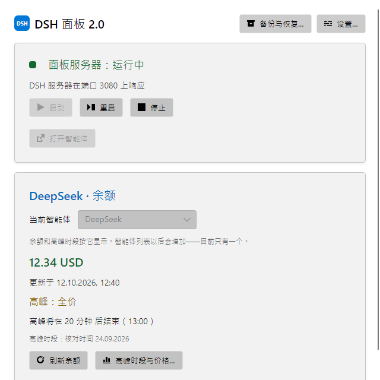

<p align="center">
  
</p>

<h1 align="center">DSH Panel</h1>

<p align="center">
  Windows 上本地 <b>DeepSeek Harness</b> 服务器的管理面板：<br>
  从托盘启动并看护服务器，按已核验的版本集合自行安装和更新 DSH，显示余额与高峰时段，
  创建和恢复备份，用手机回答智能体的提问，并更新自己。
</p>

<p align="center">
  <a href="https://github.com/Danerus23/dsh-panel/releases/latest"></a>
  <a href="LICENSE"></a>
  
  
  <a href="https://github.com/Danerus23/dsh-panel/releases"></a>
</p>

<p align="center">
  <a href="#210-新内容">2.1.0 新内容</a> ·
  <a href="#如何更新">如何更新</a> ·
  <a href="#安装">安装</a> ·
  <a href="#功能">功能</a> ·
  <a href="#暂不具备">暂不具备</a> ·
  <a href="#界面截图">界面截图</a> ·
  <a href="#从源码构建">从源码构建</a> ·
  <a href="#支持这个项目">支持</a> ·
  <a href="README.md">English</a> ·
  <a href="README.ru.md">Русский</a>
</p>



**你的 DSH 服务器，尽在掌握**——而且安静地待在托盘里。只有一个文件 `DshPanel.exe`：安装到用户
配置文件里，不需要管理员权限，也不需要单独安装 .NET——运行时就在程序内部。面板版本 **2.1.0**。

启动和停止服务器、按已核验的版本集合安装和更新 DSH、用颜色显示状态的托盘图标、余额、高峰时段
与价格历史、带恢复的数据备份、用手机回答智能体的提问、面板自我更新——而且**支持三种语言：
俄语、英语和中文**。

高峰时段按**你的本地时间**显示；价格带着变更历史，而不是靠记忆；登录链接只在你点击时才打开。

不需要手动解压任何东西：DSH 由面板从 npm 按已核验的版本集合安装，因此需要网络。面板不做什么，
见[“暂不具备”](#暂不具备)。

俄语是原文。**英语和中文由机器翻译**：意思准确，但个别措辞可能不够地道。

## 2.1.0 新内容

* **手机可以回答智能体的提问。**设置里新增「手机」部分：开关、端口、有有效期的六位数字配对码，
  以及用相机直接打开手机页面的**二维码**。手机页面就是智能体的提问：文字与可选答案，还有
  「取消智能体的运行」按钮，它会直接说明这一轮的工作不会再继续。
* **面板自己安装 DSH 服务器——依据已核验的版本集合：**所有包的确切版本和校验和，安装后按路径
  核对树的内容。
* **它也会更新和回退这个服务器。**替换版本之前面板一定会问、保存配置的保护副本、**只停止自己的**
  服务器，并**对版本做实时检查**；没通过——重新启动原来的版本。系统 Node 版本不合适时，面板会
  下载自己的 Node。
* **「服务器」部分说明面板对这个服务器能做什么**——逐项用文字写成：已检查 · 不可用 · 未检查。
  缺少所需能力时，功能会用文字拒绝，而不是沉默。
* **面板从本次发布更新自己：**文件分块下载，**在文件占据工作位置之前**核对总 SHA-256，
  失败的检查不再看起来像「还没有检查过」。

## 如何更新

打开**「更新」**部分，按「立即检查」。面板会找到 2.1.0，从本次发布下载 `DshPanel.zip`，
核对校验和，并**在面板退出后**替换文件；替换前会先保存上一个版本的保护副本。不需要手动解压，
也不需要卸载任何东西。

发布文件里的安装程序 `dsh-panel-setup.exe` 用于**已关闭**的面板：它会自己结束正在运行的面板，
所以请先从托盘菜单「退出」，而不是「停止」——「停止」会连同智能体的工作一起停掉 DSH 服务器。

这次更新与你无关的部分、以及面板不做什么——见[“暂不具备”](#暂不具备)。

## 安装

1. 从[最新发布](../../releases/latest)下载安装程序 `dsh-panel-setup.exe` 并运行。它把面板
   **安装到当前用户的配置文件中**——`%LOCALAPPDATA%\Programs\DSH Panel`——并且**不要求管理员权限**。
2. 或者使用便携版压缩包 `DshPanel.zip`：解压到任意目录，运行 `DshPanel.exe` 即可，系统上不会留下
   其他改动。
3. 然后按 **“启动”**：面板会拉起你的 DSH 服务器并显示状态。登录链接由单独的按钮打开。
4. 完全没有 DSH 服务器时，由「更新」部分按已核验的集合安装；缺少什么，面板在首次启动时会
   自己说明。

如果你已经装过**更早的面板**，安装程序会直接覆盖：两者使用同一个包标识，因此托盘里只有一个
面板，而不是两个。较早的面板也可以自己更新——见[“如何更新”](#如何更新)。

**运行条件：** Windows 10 或 11，x64。不需要安装 .NET。还需要网络：DSH 由面板从 npm 按已核验
的集合安装（见“暂不具备”）。

## 功能

### 服务器

启动、重启和停止本地 DSH 服务器。面板显示的是真实状态：正在运行、已停止，或端口被别的程序
占用。登录链接**只在你点击时**才在浏览器中打开——面板自己既不会打开它，也不会显示它。旁边是
服务器日志：可以看到它启动时输出了什么。

### 接管已在运行的 DSH

如果 DSH 服务器已经起来了，面板会在 3080 端口或其他端口上找到它，把发现的结果显示给你，并询问
是否接管。你的回答会被**记住**，下次启动时面板会直接接管同一个服务器。只要旁边还有别人的服务器
在响应，面板就不会再启动自己的服务器——同一份数据上不会出现第二个引擎。如果机器上运行着不止
一个 DSH，面板会为每个显示一行，标注「面板服务器」或「发现的服务器」，每个都有自己的
「接管」按钮。

### DSH 服务器：安装、更新、回退

面板按**已核验的版本集合**安装 DSH 服务器——所有包的确切版本和校验和——安装后按路径核对树的
内容。「更新」部分里有「DSH 服务器」区块：第一行是**你当前的**版本，接着是**推荐的**（已核验）
和**最新的**（来自 npm 注册表），并用文字说明它们的区别。主按钮只安装已核验版本；最新版本是
单独的操作，需要确认；完全没有服务器时，按钮叫「安装」。

在替换版本之前，面板一定会问：「将停止 DSH 服务器、保存副本、安装 {版本}；智能体的工作会中断」。
它会保存配置的保护副本（副本失败就拒绝更新——不存在半个归档），**只停止自己的**服务器，安装
已核验版本，并**对已安装的东西做实时检查**：在自己的临时目录里用空闲端口把它启动起来并跑一遍
探测。通过——服务器在新版本上重新启动；没通过或中途出错——重新启动**原来的**版本。话在事前，
一行在事后。

「返回到版本 {X}…」只有在可以返回时才可见。面板一定会问，并且**直说**会话的事：它们的日志更新，
旧服务器打不开它们。如果系统 Node 版本不合适，面板会下载**自己的** Node——来自官方来源并核对
校验和。

### 手机

设置里有「手机」部分：「允许手机连接」开关、端口、「显示配对码」按钮——**六位数字**，有有效期；
已连接设备列表，每一项都有「解除绑定」；还有面板等待手机连接的地址。旁边是带地址和端口的
**二维码**：相机可以直接打开手机页面，不用手动输入配对码。托盘菜单里有「手机：已连接」或
「手机：等待连接」这一行。

手机页面就是智能体的提问：文字与可选答案——可以选择作答，也可以在都不合适时写自己的答案，
答案**只提交一次**。单独的「取消智能体的运行」按钮会直接说明：这一轮的工作不会再继续。手机的
防火墙规则**只在您点击时**才添加，而且很窄：仅专用配置文件、仅面板端口、仅此程序、仅本地子网。

手机在自己的网络内工作，不向外连接。用手机布置任务和管理智能体仍在开发中。

### 托盘

托盘图标用颜色显示状态：绿色——服务器有响应，红色——没有响应，灰色——面板不知道服务器的情况。
图标角上还有一个高峰指示灯。点击图标打开窗口，右键打开菜单，菜单顶部有三行状态：服务器、
带余额的智能体，以及资费。关闭按钮和“最小化”都会把窗口收进托盘，服务器继续运行。

### 余额与高峰时段

余额用当前模型的密钥读取，按计划刷新。高峰时段按**你的本地时间**显示。面板会在高峰即将开始时
和余额低于阈值时通知你，也会说明距离资费切换还有多久。启动时，面板会用气泡告诉你它在运行。

### 价格与价格历史

“费用”表来自价格页面。除此之外，面板单独保存一份**变更历史**：只有当价格或高峰时段
**真的发生变化**时才会留下一条记录。每条新记录都与上一条对比，最新的一条标注为“当前”，
涨价用红色向上箭头表示，降价用绿色向下箭头表示。发生变化时，气泡会说明**到底变了什么**。

### 备份与恢复

DSH 数据的备份是一个 ZIP 压缩包。面板会列出已有的备份；恢复之前先给出计划：究竟会恢复什么、
恢复到什么地方，此时磁盘上什么都不改。恢复会先为当前状态做一份保险备份；自动备份按计划创建
并按数量轮换；备份体积有三种模式。`~/.dsh` 之外的**私钥**只有单独许可后才会进入备份，此时压缩
包本身就是密钥。**“用于分享的备份”是一次性的动作，而不是设置：**备份窗口里的勾选在备份完成后
会自动取消，没有窗口的备份有自己的 `--shareable` 参数，夜间自动备份永远不会是可分享的。这种
备份里根本不放入访问密钥文件，因此可以交给别人。**“私钥 + 分享”的组合被禁止**，面板会拒绝并
说明原因。

### 更新自己

面板每天自动查询一次发布，用**面板自己的语言**显示发行说明，并支持“跳过此版本”。答复——既装的是
什么、又出了什么——住在**设置的「更新」分区里**：更新没有单独的窗口。下载的内容会用 SHA-256
校验，解压时核对版本，文件替换由一个单独的脚本完成，**并且可以回退**到上一个版本。替换结果面板
会用文字说明：已更新、已回退，或者替换的不是面板所在的那个目录。

### 三种语言

俄语、英语和中文。语言切换在设置里。

### 报告问题

“关于”窗口里有一个报告按钮。面板会整理一份技术报告，并**把将要发出的文本原样显示给你**。
它不会自己发送任何东西：只有你按下按钮，报告才会走出去——在浏览器中打开新的 issue、复制，
或保存到文件。模型密钥、余额和登录链接都不会进入报告。

### 设置

随 Windows 启动、界面主题（浅色、深色或跟随 Windows）、自有服务器端口，以及服务器工作目录。
“服务器”一节里有环境报告：面板找过什么、找到了什么，DSH、Node、npm 和 pnpm 各是什么版本、
具体在什么路径下。同一节里还有能力表：面板对这个 DSH 服务器能做什么，每项能力都用文字说明。

## 暂不具备

* **手机只回答智能体的提问，别的还不行。**用手机布置任务和管理智能体仍在开发中。手机流量在
  网络上**不加密**——登录由六位代码和设备通行证保护——而且它不向外连接。
* **发布包里没有引擎，也没有 Node。**安装程序和压缩包都不带这两样：面板按已核验的集合
  **从 npm** 安装 DSH，因此需要网络。系统 Node 合适就用它；不合适——面板会下载自己的 Node。
* **没有代码签名——SmartScreen 会提示你。**首次运行时它会说发布者未知：签名证书没有购买。
  这是预料之中的；你仍然可以点“更多信息”→“仍要运行”来继续安装。
* **面板只安装和更新自己的 DSH 服务器。**别人的安装它从不碰：只显示版本以及能对它做什么。
  注册表里的最新版本会显示，但在为它取到已核验的集合之前不会安装。
* **高峰排程是按周的。**表格按星期几排列，和价格页面上一样：它不认识中国的节假日。

## 界面截图

每个窗口都有三种语言——语言切换就在设置里。


面板的多个窗口。

| | English | Русский | 中文 |
| --- | --- | --- | --- |
| 主窗口 | [panel](docs/screenshots/en/panel.png) | [панель](docs/screenshots/ru/panel.png) | [面板](docs/screenshots/zh/panel.png) |
| 高峰时段与价格 | [peaks](docs/screenshots/en/peaks.png) | [пики](docs/screenshots/ru/peaks.png) | [价格高峰](docs/screenshots/zh/peaks.png) |
| 价格历史 | [price history](docs/screenshots/en/pricing-history.png) | [история цен](docs/screenshots/ru/pricing-history.png) | [价格历史](docs/screenshots/zh/pricing-history.png) |
| 设置 | [settings](docs/screenshots/en/settings.png) | [настройки](docs/screenshots/ru/settings.png) | [设置](docs/screenshots/zh/settings.png) |
| 关于 | [about](docs/screenshots/en/about.png) | [о программе](docs/screenshots/ru/about.png) | [关于](docs/screenshots/zh/about.png) |
| 面板更新（设置分区） | [update](docs/screenshots/en/update.png) | [обновление](docs/screenshots/ru/update.png) | [更新](docs/screenshots/zh/update.png) |
| 手机（设置分区） | [phone](docs/screenshots/en/phone.png) | [телефон](docs/screenshots/ru/phone.png) | [手机](docs/screenshots/zh/phone.png) |
| DSH 服务器（设置分区） | [server](docs/screenshots/en/server.png) | [сервер](docs/screenshots/ru/server.png) | [服务器](docs/screenshots/zh/server.png) |
| 首次启动 | [first run](docs/screenshots/en/first-run.png) | [первый запуск](docs/screenshots/ru/first-run.png) | [首次启动](docs/screenshots/zh/first-run.png) |

## 从源码构建

```powershell
git clone https://github.com/Danerus23/dsh-panel.git
cd dsh-panel

dotnet build DshPanel.slnx -c Release
dotnet test tests\DshPanel.Tests\DshPanel.Tests.csproj -c Release
dotnet publish src\DshPanel\DshPanel.csproj -p:PublishProfile=win-x64 -o dist
```

发布配置会产出单个自带运行时的 `DshPanel.exe`，.NET、Skia 和 HarfBuzz 都在里面——运行它的
机器不需要安装 .NET。

构建需要 **.NET SDK 10**（版本锁定在 `global.json` 里）和网络连接，因为包要从 NuGet 还原。
安装程序由 [Inno Setup 7](https://jrsoftware.org/isdl.php) 通过 `installer\build-installer.ps1`
构建，发布文件同样由它放进 `dist\`。构建本身不需要 Node 和 pnpm——它们是用来启动服务器的，
不是用来构建面板的。

## 支持这个项目

面板免费、开源，并且会一直如此——没有付费版本，也没有这个打算；捐赠用于开发时间：
代码、构建和在干净 Windows 上的验证，通过 [lava.top](https://app.lava.top/3686297587)。

> **非官方工具。** DSH Panel 是为 DeepSeek Harness 智能体做的面板：它调用官方的 `dsh`
> 命令行，不修改它。DeepSeek 和 DeepSeek Harness 是其所有者的商标。

## 许可证

MIT——见 [LICENSE](LICENSE)。
